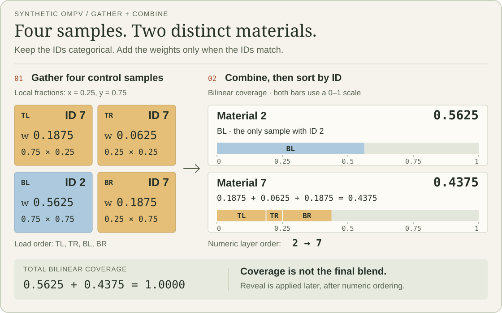

# Cold War OMPV shader study

A technical study of **One Material Per Vertex (OMPV)** terrain composition in **Call of Duty: Black Ops Cold War**, by Kxboo / SuperTerrain contributors. Published October 29, 2026.

**[Read the study online](https://kxboo.github.io/cold-war-ompv-study/).** Follow the capture workflow, replay contract, validation evidence and surface-sound integration through nine chapters with source links. An optional, collapsed example at the bottom shows how four control samples combine into material coverage; expand it to experiment with sample position, IDs and reveal after reading the mechanics.

**Cold War’s own materials, blended live in Black Ops 3.** The BO3 terrain uses Cold War’s `zm_silver` layer textures, taken directly from the game, together with the exported [300-entry layer table and control maps](docs/03-shader-port.md#the-zm_silver-inputs). Layer-record and control-map values stay unchanged. Each captured layer texture keeps its native resolution and is packed into a material atlas without resizing; BO3 compresses the material atlases again, while control maps stay uncompressed. **Cold War’s translated terrain shader blends the layers live, per pixel, in game; the terrain material is never baked or blended in advance.** The table contains 44 captured records and 256 zero-filled padding records.

The saved comparison gives **99.96% when expressed as 100 × (1 − normalized mean colour error)**: colour MAE is **0.1133544743/255** over one **1024 × 1024** tile, comparing the translated shader with Cold War’s own terrain shader in Greyhound’s reference bake. This is an offline shader-output result, not a measured match between final in-game images. [How the percentage is calculated](docs/04-validation.md#what-9996-means).

**The reference bake executes Cold War’s original captured shader unchanged**, using captured layer resources under the documented replay inputs. [See the actual saved reference and port images](https://kxboo.github.io/cold-war-ompv-study/#comparison). A fresh comparison of their 8-bit previews finds **82.24% identical RGB pixels** and **98.88% within 1/255 in every colour channel**. [Image checks and fidelity limits](docs/04-validation.md#saved-colour-previews).

**The terrain now has surface-based footsteps and impacts.** Cold War’s captured collision surface map selects snow, rock, dirt, ice, mud and concrete responses in BO3. Six surface variants share the visual shader with the base material; **93.48% of the covered source samples retain their category** in the current playable patches. [Surface sounds, seamless shading and collision](docs/09-surface-sounds.md).

OMPV stores a material ID at each control-map texel. Shading gathers four IDs, combines repeated materials, and evaluates the resulting layers in order. Reveal maps shape the transitions. This compact representation is an input to material composition; virtual texturing handles storage and reuse of the composed result.

The study connects the public terrain presentations to Cold War capture observations and a later DXIL-to-HLSL port experiment. The saved comparison has **100% validity agreement** under the bake’s reconstructed inputs, provisional samplers and omitted weather globals. It does not establish full-frame or all-map equivalence.



[Open the diagram at full size](assets/ompv-gather.svg).

## Read the study

| Topic | Contents |
| --- | --- |
| [OMPV mechanics](docs/01-ompv-mechanics.md) | Coordinate convention, integer gathering, bilinear coverage, duplicate combination, colour controls, ordering and reveal |
| [Cold War evidence](docs/02-cold-war-evidence.md) | Captured formats, surface-local bindings, the earlier material-shader dead end, and the renderer-owned composition path |
| [Greyhound capture workflow](docs/06-capture-workflow.md) | Asset discovery, build gates, resource reads, shader ownership, stability checks and evidence retention |
| [Offline replay contract](docs/07-replay-contract.md) | File formats, D3D12 bindings, reconstructed constants, samplers, outputs and runnable commands |
| [Isolated shader experiments](docs/08-shader-experiments.md) | Pointer-reference discovery, observed reveal equation, distortion, colour blending and normal decoding |
| [Shader port](docs/03-shader-port.md) | Compute-to-pixel adaptation, resource repacking, derivatives, output channels and exactness limits |
| [Validation and reproduction](docs/04-validation.md) | Exact saved metrics, failure cases, synthetic checks and comparison of user-supplied outputs |
| [Surface sounds and collision](docs/09-surface-sounds.md) | Captured surface categories, shared-shader material variants, mapping accuracy, navmesh and the seven-material origin rule |
| [Sources and provenance](docs/05-sources.md) | Primary presentations, pinned Greyhound source and hashes of the local research evidence |

## Run the example

The educational model uses Python 3.10+ and only the standard library:

```console
python examples/ompv_reference.py
python -m unittest discover -s tests -v
python tools/make_diagram.py
```

The example prints the four gathered IDs and weights, followed by their combined contributions. Its synthetic grid contains no game assets. [The HLSL companion](shaders/ompv_reference.hlsl) implements the same gather/combine and illustrative reveal operations as a self-contained compute example. It is a teaching implementation, not the recovered Cold War shader.

For comparison of existing shader output files, install NumPy with `python -m pip install -r requirements-analysis.txt`, then follow the [validation instructions](docs/04-validation.md).

To verify the capture chapter's pinned source references against your Greyhound clone:

```console
python tools/verify_greyhound_sources.py --greyhound PATH_TO_GREYHOUND
```

The verifier checks Git blob hashes and 40 cited line ranges from the [source ledger](evidence/greyhound-source-map.json). It reads the pinned commit, so unrelated working-tree changes do not change the result.

## Work on the site

The site is static HTML, CSS and JavaScript. Generate its chapter reader, then serve it locally:

```console
python tools/build_site.py
python -m http.server 8000 --directory site
```

Open `http://localhost:8000`. GitHub Actions publishes `site/` to GitHub Pages when `main` changes. The browser examples use synthetic data and run locally without a game installation.

## Research status

**Established in scope:** the public OMPV mechanism, repeated index/colour/control patterns in four earlier captures, the reference bake's shader identity and public capture path, saved controlled-equation experiments, the port's documented substitutions, and the saved per-channel comparison.

**Still open:** unexplained outliers, coverage across maps and shader permutations, exact captured-frame resource state, behaviour with weather/decal passes, and equivalence at distant pixel footprints. The RGB control's absolute application cannot be inferred from a successful colour-correlation fit alone.

The repository contains original explanations, synthetic examples, selected numerical evidence and two saved shader-output previews. Captured source-layer textures, shader binaries/disassembly, game maps, and the full BO3 integration remain external inputs. The previews' game-derived artwork is attributed in [NOTICE.md](NOTICE.md). The earlier Python reconstruction tools and the later shader port are distinct experiments; their results are not interchangeable.

## Credits

The terrain design is described by J.T. Hooker's [GDC 2021 presentation](https://research.activision.com/publications/2021/09/boots-on-the-ground--the-terrain-of-call-of-duty) and Stephane Etienne's [SIGGRAPH 2023 presentation](https://advances.realtimerendering.com/s2023/index.html). Capture and reference baking use [Kxboo/Greyhound](https://github.com/Kxboo/Greyhound), based on Scobalula's Greyhound and Wraith Archon. See [NOTICE.md](NOTICE.md) for attribution and scope of the [MIT license](LICENSE).
