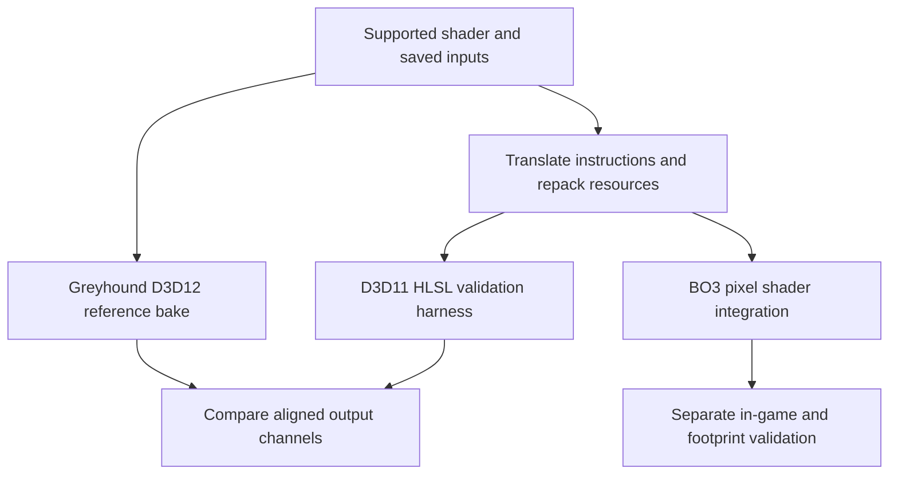

# The composition shader port experiment

## Reference and target

The reference path runs the supported Cold War compute bytecode on D3D12 WARP. The experimental port translates its DXIL listing into HLSL and runs through a D3D11 WARP harness. BO3 integration evaluates the translated composition from a pixel shader. These are separate execution contexts.



The translator aims to preserve arithmetic and control flow while adapting operations the target cannot express directly. Its source and the binding implementation are identified by SHA-256 in [provenance.json](../evidence/provenance.json). The full integration is external to this study; the included HLSL file is a small explanatory example.

## The zm_silver inputs

The Black Ops 3 integration uses Cold War’s own `zm_silver` layer textures, captured directly from the game, alongside the captured layer table and control maps. The generated resource header contains **300 records of 128 bytes each**: **44 captured records plus 256 zero-filled padding records**. These are not 300 distinct terrain materials. Greyhound explicitly appends the padding when exporting the table; the BO3 resource packer preserves the table’s raw integer bits. See the [resource inspection](../evidence/port-resources.json) and [pinned capture code](https://github.com/Kxboo/Greyhound/blob/2f3d1020ede04602759d5eb68405df519ec8221b/src/WraithXCOD/WraithXCOD/games/cold_war/terrain/CWTerrainBake.h#L162).

Each captured layer texture retains its native width and height. The packer decodes and places those texels into atlases without resizing, adds wrap borders, and records the original dimensions for sampling. BO3 then recompresses the material atlases and builds mip chains. Control-map values are packed losslessly and loaded exactly, without lossy compression. “Native resolution” here means the captured source level used by the reference bake; it does not assert that the capture retained every available higher-resolution streaming mip.

**Cold War’s translated terrain shader blends these layers live, per pixel, in Black Ops 3. The terrain material is never baked or blended in advance.** Atlas packing changes storage, not the authored layer assignment or material composition. The separate reference bake supplies validation output; it is not the material texture installed on the BO3 terrain. Recompression, atlas borders, mip generation and the shader substitutions below mean this is not a byte-for-byte copy of every resource or of the complete Cold War rendering pipeline.

## Three substitutions require special attention

1. **Invocation position.** Compute dispatch derives world XY from thread ID, origin and step. The port supplies world XY and two neighbouring positions explicitly. A pixel shader uses its screen-space world-position derivatives; the validation harness supplies the original bake step.
2. **Resource access.** Bindless descriptors become binding-interface calls. Layer textures occupy atlases; integer controls are packed into lossless byte images and reconstructed through exact loads. Atlas coordinates retain each source image's native dimensions and an eight-texel wrap border.
3. **Group-shared operations.** The quad derivative exchange is rebuilt using neighbouring positions. The port replaces the shared `gHeightCacheDisplace` reduction with a per-texel value. Following that replacement through the generated assignments places its result in **`vt2.y`**. The translator's introductory comment incorrectly says `vt2.w`; the implementation trace takes precedence. The reported comparison evaluates only `vt2.x`, so it does not validate this reduction or establish equivalence of all output channels. See the [channel audit](08-shader-experiments.md#normal-decoding-and-the-reduction-channel).

The shader gate needs care: the inspected translator checks an adjacent binary if present, but permits translation of a listing when that binary is absent. A constant hash printed in a generated header is not proof of input identity. Reproduction must explicitly hash the captured binary and establish that the disassembly came from it.

## Atlases and filtering

Resampling source textures changes the effective signal, even if the atlas UV math looks plausible. The later resource packer preserves native texture sizes. Control maps use exact byte recovery; material colour sampling observes the appropriate colour-space conversion. A map-wide integer index must not pass through colour conversion, lossy compression or interpolated material IDs.

At the bake's own texel step, its one-mip material inputs select mip zero. The pixel integration applies this footprint-dependent LOD rule:

```text
lod = max(0, min(hardware_lod, log2(pixel_world_footprint / bake_step)))
```

The harness runs at a footprint ratio of one. Agreement there does not validate all distant footprints. Sampling lower mips of each source material before nonlinear reveal/composition is not generally identical to filtering an already composed result. Atlas borders and mip generation also need verification at coarser levels, especially between unrelated atlas cells.

## Output interpretation

| Output | Interpretation used by the bake / comparison | Qualification |
| --- | --- | --- |
| `vt0.rgb` | Encoded colour | Reported as `colour_srgb` |
| `vt0.a > 0.5` | Validity mask | Evaluated separately from colour error |
| `vt1.xy` | Encoded detail-normal components | Error here is not a decoded normal-vector angle |
| `vt1.z` | Roughness | Bake's gloss image uses `1 - roughness` |
| `vt2.x` | Ambient occlusion | Scalar comparison |
| `vt2.y` | Receives the substituted shared-reduction result | Outside the reported equivalence scope |
| `vt2.zw` | Other outputs | Outside the reported equivalence scope |

The bake decodes the two normal components using:

```text
q  = (encoded_xy - 0.5) * 4
l2 = dot(q,q)
xy = q * sqrt(max(0, 1 - l2/4))
z  = 1 - l2/2
```

Its conventional exported map flips the green component for the export frame. The BO3 pixel integration instead projects the detail normal using terrain orientation and its G-buffer conventions. Neither should be described as a direct copy of a final lit Cold War pixel. [Public output-map conversion](https://github.com/Kxboo/Greyhound/blob/2f3d1020ede04602759d5eb68405df519ec8221b/tools/cold_war/terrain/output_maps.py).

## Further experiments

Prioritize boundary crops and the largest outliers, then additional tiles and maps. Compare encoded and decoded normal errors separately. Add explicit weather, decal, sampler, source-mip and shader-permutation coverage. For the pixel integration, sweep footprints and camera distances against a well-defined filtered reference, and validate the geometry frame independently.
