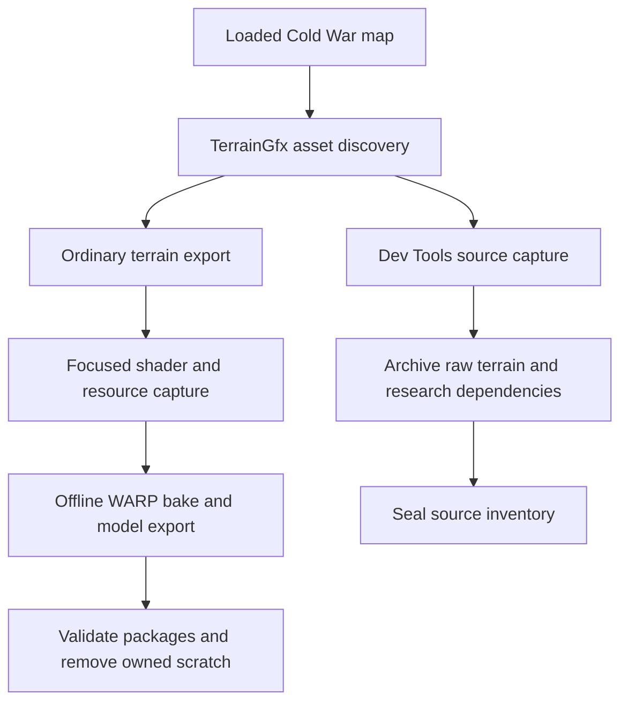

# How Greyhound captures the Cold War composition inputs

This chapter follows the implementation in [Kxboo's Greyhound fork at `2f3d102`](https://github.com/Kxboo/Greyhound/tree/2f3d1020ede04602759d5eb68405df519ec8221b). It connects the loaded game's terrain asset to the saved shader, native texture blocks and GPU parameter records that drive the reference bake. The capture is a sequence of bounded process reads and package extraction; it is not a graphics debugger's atomic frame capture.

## Two export paths with different purposes

Greyhound dispatches terrain assets according to `TerrainSourceOnly`. The ordinary path calls `ExportBakedTerrain`; the source-only path calls `ExportTerrainAsset`. The distinction matters because their evidence and retention policies differ. [Export dispatch](https://github.com/Kxboo/Greyhound/blob/2f3d1020ede04602759d5eb68405df519ec8221b/src/WraithXCOD/WraithXCOD/assets/CoDAssets.cpp#L1340-L1343).

| Path | Main purpose | Relevant implementation | What survives success |
| --- | --- | --- | --- |
| Ordinary terrain export | Produce models and composed material maps | `CWTerrainBake::Capture` → `bake.py` → model export → `finalize.py` | Final packages, inventories and source hashes; owned `_work` is removed |
| Dev Tools terrain source | Archive terrain bytes and research dependencies | `ExportTerrainAsset` → `ExportTerrainResearch` and shared capture helpers | Sealed `_source/capture/` evidence and `research_capture.report.json` |

The archival material-shader dump is not automatically a dump of the renderer-owned OMPV composition pass. Its shader capture helper explicitly records that limitation. [Technique-associated shader capture](https://github.com/Kxboo/Greyhound/blob/2f3d1020ede04602759d5eb68405df519ec8221b/src/WraithXCOD/WraithXCOD/assets/TerrainResearchCapture.h#L351-L374).



## 1. Find the loaded TerrainGfx asset

`GameBlackOpsCW::LoadOffsets` first tries known module-relative asset-pool locations. It validates the expected XModel hash and animation/model/image structure sizes before accepting the layout. A fallback scans code signatures for pool and string-table references and repeats those checks. This supports discovery of the asset-pool directory; it does not make the later composition-global offsets build-independent. [Known offsets and validation](https://github.com/Kxboo/Greyhound/blob/2f3d1020ede04602759d5eb68405df519ec8221b/src/WraithXCOD/WraithXCOD/games/cold_war/reader/GameBlackOpsCW.cpp#L174-L241), [fallback](https://github.com/Kxboo/Greyhound/blob/2f3d1020ede04602759d5eb68405df519ec8221b/src/WraithXCOD/WraithXCOD/games/cold_war/reader/GameBlackOpsCW.cpp#L243-L320).

TerrainGfx uses pool `0xB1`, with 0x20-byte pool descriptors. The loader reads the bounded allocated pool, walks its capacity and skips records whose first qword is zero or points back into the pool. Walking only the loaded count would miss occupied slots beyond holes. Names are masked to 60 bits and resolved if possible; otherwise the asset receives a `terraingfx_<hash>` name. The resulting asset carries the live record pointer and size. [Pool constants](https://github.com/Kxboo/Greyhound/blob/2f3d1020ede04602759d5eb68405df519ec8221b/src/WraithXCOD/WraithXCOD/games/cold_war/reader/GameBlackOpsCW.cpp#L163-L170), [capacity walk](https://github.com/Kxboo/Greyhound/blob/2f3d1020ede04602759d5eb68405df519ec8221b/src/WraithXCOD/WraithXCOD/games/cold_war/reader/GameBlackOpsCW.cpp#L1580-L1627).

The desired map must remain loaded. Finding an asset by name identifies a record; it does not establish that every resource needed by the shader is resident or belongs to a synchronized frame.

## 2. Gate the supported build and obtain GPU records

The production `CWTerrainBake::Capture` checks the game's PE timestamp `0x6a03ba27` and image size `0x1f958a00`. It then reads the 296-byte (`0x128`) TerrainGfx header and its mapping-root array. Mapping count must be between 1 and 32. These are explicit gates for the inspected implementation, not offsets to assume for other builds. [Build and mapping checks](https://github.com/Kxboo/Greyhound/blob/2f3d1020ede04602759d5eb68405df519ec8221b/src/WraithXCOD/WraithXCOD/games/cold_war/terrain/CWTerrainBake.h#L94-L105).

The frame pointer comes from module base plus `0x17c43698`. From that frame, the capture reads a tile-list descriptor at `+0x28a780` and a layer-list descriptor at `+0x28b8a0`. It tries up to 100 times with a five-millisecond delay because the lists can be empty during reset. Tile count must cover the mapping roots and be at most 2560; layer count must be 1–4096. The capture rereads both arrays and both list descriptors, accepting a pass only when each matches its preceding read. [Frame-list acquisition](https://github.com/Kxboo/Greyhound/blob/2f3d1020ede04602759d5eb68405df519ec8221b/src/WraithXCOD/WraithXCOD/games/cold_war/terrain/CWTerrainBake.h#L106-L120).

| Record | Size | Role |
| --- | ---: | --- |
| TerrainGfx header | 296 bytes | Mapping roots and image tables |
| CPU mapping root | 472 bytes | Terrain extent, origin, cell size and shared indices |
| GPU tile | 316 bytes | Composition transforms, packed resource IDs and parameters |
| GPU layer | 128 bytes | Material parameters used by the composition shader |
| Archival layer image-pointer record | 96 bytes | Separate array of 12 image pointers |
| Archival painted-slot record | 304 bytes (`0x130`) | Separate CPU material-slot representation |

The first four layouts are used by the focused bake capture. The final two belong to the archival research path. Similar names do not make the records interchangeable. [Focused capture](https://github.com/Kxboo/Greyhound/blob/2f3d1020ede04602759d5eb68405df519ec8221b/src/WraithXCOD/WraithXCOD/games/cold_war/terrain/CWTerrainBake.h#L103-L142), [archival records](https://github.com/Kxboo/Greyhound/blob/2f3d1020ede04602759d5eb68405df519ec8221b/src/WraithXCOD/WraithXCOD/games/cold_war/reader/GameBlackOpsCW.cpp#L751-L774).

## 3. Join mapping roots, GPU tiles and image IDs

For each mapping root, the capture selects the corresponding leading GPU tile and checks dimensions independently: uint16 width/height at root `+0x100/+0x102` must equal the tile's float dimensions at `+136/+140`. Dimensions must be nonzero multiples of 32 and at most 8192. It also requires an identity rotation, a sensible cell size and 6144 shared uint16 indices. These checks support the assumed mapping order for the accepted layout; they do not independently identify every tile by a persistent engine ID. [Mapping checks and output metadata](https://github.com/Kxboo/Greyhound/blob/2f3d1020ede04602759d5eb68405df519ec8221b/src/WraithXCOD/WraithXCOD/games/cold_war/terrain/CWTerrainBake.h#L121-L142).

The mapping supplies world origin and cell size. The GPU record supplies the transforms used for height sampling and material composition. Tile words at byte offsets 300, 304, 308 and 312 are split into two 14-bit IDs each to identify resources that require full-resolution capture.

The TerrainGfx header's image count is at `+48`, image-pointer-table pointer at `+56`, and uint32 ID-table pointer at `+72`. The capture accepts 1–4096 images and requires unique IDs in `1…16383`. Each resulting `texture_<ID>.bin` is associated with that ID, its native DXGI format, actual dimensions and package provenance. These descriptor IDs are not the byte-valued OMPV material indices. [Image table and capture loop](https://github.com/Kxboo/Greyhound/blob/2f3d1020ede04602759d5eb68405df519ec8221b/src/WraithXCOD/WraithXCOD/games/cold_war/terrain/CWTerrainBake.h#L143-L151).

## 4. Recover native image bytes

`CaptureImage` reads the 208-byte image header, including format, dimensions, mip table and resident-data location. For streamed images it walks installed package mips from largest to smallest. Ordinary material textures are limited to an available level no larger than 1024 pixels; height/control resources and the separately captured distortion image require full resolution. The saved image is one mip at the selected dimensions. [Image acquisition](https://github.com/Kxboo/Greyhound/blob/2f3d1020ede04602759d5eb68405df519ec8221b/src/WraithXCOD/WraithXCOD/games/cold_war/terrain/CWTerrainBake.h#L54-L92).

Payload size is calculated from format and dimensions, including block-compressed extents. Package decoding is attempted first, with a raw-package fallback requiring the expected extent. A decoded package can contain a mip tail, but only the calculated selected-level bytes are saved. A resident fallback reads process memory and compares the pixels on a second read. Image headers and mip tables are also reread. A full-resolution request fails if only a smaller image is available. [Format byte sizes](https://github.com/Kxboo/Greyhound/blob/2f3d1020ede04602759d5eb68405df519ec8221b/src/WraithXCOD/WraithXCOD/games/cold_war/terrain/CWTerrainBake.h#L42-L52).

This preserves native texture blocks for Direct3D to decode. A visually convenient PNG or an old DDS header is not substituted for the captured format. The chosen source mip is still a capture limitation: native bytes do not imply the highest possible installed or authored resolution.

## 5. Recover distortion and the composition binary

The production code follows two build-specific globals:

```text
module + 0x1a188058 -> distortion image pointer -> CaptureImage(full resolution)

module + 0x182aa760 -> composition owner
owner + 0          -> expected asset hash 0x60e23a45408923cb
owner + 8          -> expected value 1
owner + 16         -> pointer table -> first shader descriptor
descriptor + 16    -> bytecode pointer
descriptor + 24    -> uint32 byte count
```

The descriptor's byte count must be between 32 and 1,048,576. The payload is saved unchanged as `composition.dxil`. The 64-bit owner hash and the payload's SHA-256 identify different objects. Later, `bake.py` independently requires payload SHA-256 `6159daeb7882198314ffe9e8b6fab53c1b314258b43a106c1694c5a53d77d9ff` and rejects a missing distortion entry. [Global lookup and shader extraction](https://github.com/Kxboo/Greyhound/blob/2f3d1020ede04602759d5eb68405df519ec8221b/src/WraithXCOD/WraithXCOD/games/cold_war/terrain/CWTerrainBake.h#L153-L161), [bake identity gate](https://github.com/Kxboo/Greyhound/blob/2f3d1020ede04602759d5eb68405df519ec8221b/tools/cold_war/terrain/bake.py#L97-L102).

The public production routine consumes established offsets. It does not contain their original discovery procedure. The [research-experiments chapter](08-shader-experiments.md) separately describes the saved pointer-reference and shader-argument evidence that led to this association.

## 6. Save the focused replay inputs

After adding 256 zero-initialized 128-byte records to the captured layer buffer, the capture writes `layers.bin`. It rereads the TerrainGfx header, mapping roots, image-pointer table and image-ID table before publishing `inputs.json`. The padding is an adaptation in the saved replay input, not 256 additional captured material layers. [Input sealing point](https://github.com/Kxboo/Greyhound/blob/2f3d1020ede04602759d5eb68405df519ec8221b/src/WraithXCOD/WraithXCOD/games/cold_war/terrain/CWTerrainBake.h#L162-L167).

The focused input set is:

```text
_work/
  inputs.json
  composition.dxil
  distortion.bin
  layers.bin
  tile_<mapping>.bin
  indices_<mapping>.bin
  texture_<descriptor-ID>.bin
```

`inputs.json` connects these files to dimensions, formats, IDs and mapping metadata. It is distinct from the later `dispatch.json`, which adds reconstructed generic/scene constants and output dimensions. The [replay contract](07-replay-contract.md) describes that second stage.

## What the stability checks prove

The accepted arrays and descriptors agreed on their paired reads. The image checks caught no changes within their individual read intervals, and the final root/pointer checks still matched. These are meaningful rejection gates for changing or unsupported inputs.

They do not establish one atomic state across the entire capture. In this implementation, the frame-global pointer is not checked again at the end; tile/layer arrays are not revalidated after every image is collected; shared indices and composition bytecode are not reread; and the distortion global pointer itself is not reread after image acquisition. The shader SHA establishes binary identity, not temporal synchronization. This scope follows directly from the [complete focused capture function](https://github.com/Kxboo/Greyhound/blob/2f3d1020ede04602759d5eb68405df519ec8221b/src/WraithXCOD/WraithXCOD/games/cold_war/terrain/CWTerrainBake.h#L94-L167).

The archival reader makes its narrower header-equality scope explicit as well. Do not silently promote either path into a captured GPU submission. [Archival stability report](https://github.com/Kxboo/Greyhound/blob/2f3d1020ede04602759d5eb68405df519ec8221b/src/WraithXCOD/WraithXCOD/games/cold_war/reader/GameBlackOpsCW.cpp#L879-L886).

## Practical reproduction and retention

1. Build the pinned Greyhound fork using its [Windows build instructions](https://github.com/Kxboo/Greyhound/blob/2f3d1020ede04602759d5eb68405df519ec8221b/docs/README.md#L36-L77). Keep the packaged Python/runtime helpers and package-index databases with the executable.
2. Load the supported Cold War map and attach Greyhound. For a normal bake, select the terrain asset and the intended Terrain settings. The C++ path checks that the composition runner exists, captures inputs, calls the bake and exports the selected model formats. [Production entry](https://github.com/Kxboo/Greyhound/blob/2f3d1020ede04602759d5eb68405df519ec8221b/src/WraithXCOD/WraithXCOD/assets/CoDAssets.cpp#L2600-L2697).
3. For raw archival evidence, use **Settings → Dev Tools → Terrain source capture and checks**. Enable the required pools and choose **Load Game** again to refresh the asset list. Treat this as the separate archival workflow described above. [Documented route](https://github.com/Kxboo/Greyhound/blob/2f3d1020ede04602759d5eb68405df519ec8221b/docs/capture-research.md#L9-L26).
4. Follow the output path reported by that invocation. GUI, CLI and build-only installations can have separate settings and exports. Inspect status and coverage fields before interpreting a result.

**Preserve replay inputs deliberately.** Successful normal export validates models/material maps and then removes its owned `_work` directory. Failed exports retain inputs for diagnosis. Final `terrain_export.json` retains selected source hashes, but a hash cannot reconstruct a missing texture or shader. The fork does not expose a keep-scratch flag in the inspected bake CLI. A reproducibility-focused integration must archive a separate copy before finalization, or operate on an already retained complete input set; this study does not ask readers to race the exporter or deliberately break it. [Finalizer lifecycle](https://github.com/Kxboo/Greyhound/blob/2f3d1020ede04602759d5eb68405df519ec8221b/tools/cold_war/terrain/finalize.py#L8-L54), [retained source hashes](https://github.com/Kxboo/Greyhound/blob/2f3d1020ede04602759d5eb68405df519ec8221b/tools/cold_war/terrain/bake.py#L268-L275).
